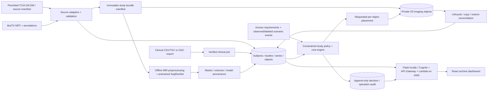

# CloudTierRecommender v2 — Product Requirements Document

**Working title:** Clinical-context-aware cloud storage optimization for multimodal cancer imaging\
**Created:** 11 October 2026\
**Status:** Target specification; product direction confirmed and local v2 milestone implemented\
**Confirmed constraints:** Cloud storage optimization is the main goal. MRI analysis supports that goal. Published pretrained models are acceptable; no training or fine-tuning is required.\
**Implementation baseline:** [Existing v1 application](PRODUCT_AND_IMPLEMENTATION.md)\
**Companion:** [Dashboard and interaction specification](DASHBOARD_V2_SPEC.md)
**Delivered scope and evidence:** [Local v2 implementation record](V2_IMPLEMENTATION.md)

## 1. Revised project goal

Build an explainable cloud archive that imports de-identified cancer imaging and clinical records, organizes complete imaging studies, analyzes compatible multimodal brain MRI using a published pretrained model, and recommends Amazon S3 storage tiers according to access needs, study completeness, retrieval-time requirements, and total storage cost.

The project should demonstrate whether a study-aware policy can reduce archive costs while keeping studies required for active research or follow-up readily accessible. Image analysis supplies inspectable research features. Explicit access requirements govern placement.

### Problem statement

Cancer imaging repositories contain many related files: DICOM instances, MRI sequences, derived volumes, segmentations, and clinical tables. Archiving these as unrelated images can fragment a useful study, hide missing sequences, and underestimate restore costs. Administrators need to see what a study contains, which clinical records belong to it, why a tier is recommended, and whether its files have actually moved.

### Faculty-facing project summary

CloudTierRecommender v2 is a cloud storage optimization system for cancer imaging archives. It extracts DICOM metadata such as modality, study and series identifiers, dimensions, and file size; links permitted clinical records using verified research identifiers; and supports BraTS-style multimodal MRI volumes. A pretrained 3D MRI segmentation model produces tumor-region masks and volume measurements for research inspection. A separate, explainable storage policy evaluates complete study bundles against access requirements and Amazon S3 cost assumptions. A redesigned dashboard combines archive inventory, data quality, clinical linkage, MRI analysis, storage recommendations, restores, and evaluation results.

### What changes from v1

| Area | Existing application | v2 requirement |
| --- | --- | --- |
| Imaging scope | Individual chest X-ray images | Cancer studies, DICOM series, and multimodal brain MRI |
| Data source | Chest X-ray workflow | TCIA collections and a specified BraTS release |
| Image model | TorchXRayVision chest X-ray DenseNet | Published MONAI BraTS SegResNet bundle |
| Metadata | Flat scan record | Subject → study → series/sequence → object hierarchy |
| Clinical context | Limited scan metadata | Separate clinical records with verified joins and missingness |
| Placement unit | Individual object/scan | Study bundle with per-object execution and reconciliation |
| Retrieval estimate | Fixed pathology-weighted probability | Transparent access scenario and explicit retrieval constraints |
| Dashboard | Scan counts, tier chart, recent decisions | Operational archive overview, study explorer, quality queue, MRI workbench, policy review, evaluation |
| Scientific claim | Engineering assumptions | Measured pipeline behavior and clearly labeled storage simulations |

## 2. Dataset feasibility and selection

**Yes, the instructor's inputs can be incorporated.** TCIA means **The Cancer Imaging Archive**. It is an archive of collections; BraTS is a family of brain tumor benchmarks. Their relationship must be established for the chosen release and subjects.

### Verified facts and their consequences

| Input | Verified source fact | Product consequence |
| --- | --- | --- |
| DICOM and study metadata | TCIA's NBIA documentation exposes study/series identifiers, modality, descriptions, image counts, and series byte counts | Build a metadata importer; reconcile downloaded and uploaded sizes rather than trusting one advertised figure |
| Clinical information | TCGA-GBM links imaging subjects to TCGA and clinical resources | Import a clinical table or GDC export separately; DICOM headers alone do not provide a complete clinical history |
| Multimodal MRI | BraTS 2021 segmentation uses NIfTI T1, T1 contrast-enhanced, T2, and FLAIR volumes; its classification task uses DICOM | Treat DICOM and NIfTI as separate supported inputs and pin the exact task/release |
| Linked TCIA/BraTS cohort | BraTS-TCGA-GBM provides processed MRI and annotations related to TCGA-GBM | Prefer this relationship for a joined demonstration, subject to verified identifiers and current access |

Sources: [NBIA metadata guide](https://wiki.cancerimagingarchive.net/display/Public/NBIA%2BSearch%2BREST%2BAPI%2BGuide), [TCGA-GBM collection](https://www.cancerimagingarchive.net/collection/tcga-gbm/), [BraTS 2021 organizers](https://www.med.upenn.edu/cbica/brats2021/), [BraTS-TCGA-GBM analysis result](https://www.cancerimagingarchive.net/analysis-result/brats-tcga-gbm/).

### Recommended acquisition plan

1. **Paired demonstration candidate:** BraTS-TCGA-GBM processed volumes and annotations, clinical records for corresponding TCGA-GBM subjects, and original DICOM where access permits. Start with 10–20 complete, verified cases. The current analysis-result page lists a 102-subject processed download; its former 33-subject test arm is unavailable. Do not plan around the historical 135-subject total as a downloadable test set. [Current availability](https://www.cancerimagingarchive.net/analysis-result/brats-tcga-gbm/).
2. **Broader MRI benchmark:** A permitted BraTS 2021 segmentation subset for inference and data-quality testing. Keep it as its own cohort unless an official crosswalk proves a clinical linkage. Challenge labels and clinical coverage vary by task and release. [BraTS task definitions](https://www.med.upenn.edu/cbica/brats2021/).
3. **Clinical-data fallback:** UCSF-PDGM supplies processed NIfTI MRI and a clinical CSV with fields such as age at MRI, sex, diagnosis, grade, and molecular markers. Use its own subject IDs and clinical records as a separate cohort. It is not a substitute source of original DICOM, and it must not be joined to unrelated BraTS subjects. [UCSF-PDGM data and glossary](https://www.cancerimagingarchive.net/collection/ucsf-pdgm/).
4. **DICOM access gate:** Some TCGA-GBM images require controlled access because of potential facial reconstruction. Confirm permission before retrieval. If the paired DICOM is unavailable, demonstrate the clinical/MRI workflow on permitted NIfTI and separately validate DICOM ingestion on a permitted collection or synthetic fixtures. A synthetic DICOM test does not establish a real TCGA/BraTS DICOM integration. [TCGA-GBM access notice](https://www.cancerimagingarchive.net/collection/tcga-gbm/).

The acquisition milestone must record the actual downloaded release, subjects, license, clinical coverage, and crosswalk. Availability and successful linkage have been researched, not demonstrated through a dataset download in this revision.

### Importer longevity

Use source adapters: local DICOM/NIfTI manifests, clinical CSV/TSV exports, and a TCIA provider adapter. TCIA identifies NBIA as a retiring legacy system, with public DICOM moving toward Imaging Data Commons and support for older API versions ending in October 2026. Do not hard-code a new importer to legacy v1/v2 endpoints. Select current documented access at implementation time and preserve a local-manifest path. [TCIA API guidance](https://www.cancerimagingarchive.net/tcia-api-guides/).

## 3. Users and primary workflow

| User | Job | Success |
| --- | --- | --- |
| Archive administrator | Inspect recommendations, set access requirements, request placement and restores | Understands the reason and observed state of every affected study |
| Researcher/viewer | Find complete MRI studies and inspect permitted clinical and analysis records | Can distinguish usable studies, missing data, and unavailable archive objects |
| Dataset/model operator | Import data, validate links and sequences, run offline inference | Reproducible manifests, clear failures, versioned outputs |
| Faculty evaluator | Review the architecture and reproduce a small demonstration | Traceable evidence of ingestion, inference, policy behavior, and costs |

**Primary workflow:** Import a collection manifest → validate files and clinical joins → assemble complete studies → run compatible MRI analysis → set study access requirements → compare eligible storage classes → review the recommendation → request placement → reconcile actual object state → record retrieval and restore outcomes.

## 4. Scope and priorities

### P0 — Required for the redesigned project

- DICOM and NIfTI import with checksums, source release, permissions, and format validation.
- Real clinical-record import with exact identifier linkage and a missingness report.
- Study/series/object inventory, complete MRI sequence sets, and measured byte sizes.
- Pretrained four-sequence MRI inference, versioned masks, derived volumes, and inspectable previews.
- Study-level access requirements and deterministic, explainable tier recommendations.
- Requested versus observed tiers; mixed study placement; bundle restore and audit history.
- Redesigned dashboard, study explorer, and study detail workflow.
- Reproducible cost simulation and retrieval-delay reporting with explicit workload provenance.

### P1 — Useful after the complete P0 path

- Side-by-side study inspection, approved batch placement, CSV report export, and collection comparison.
- Image-feature ablation to test whether MRI summaries add value to research access scenarios.
- Simulated S3 Intelligent-Tiering baseline using a documented, current price/behavior snapshot.
- DICOM viewing through a dedicated viewer integration if the available formats require it.

### Outside this revision

Clinical diagnosis, survival prediction, prognosis-based archival decisions, hospital PACS replacement, patient re-identification, automated retention deletion, model training, and paid GPU deployment. Future trained retrieval prediction requires real access labels and a separately approved research design.

## 5. Data contracts

### Extractable DICOM and image metadata

The normalized importer must allow absent fields. DICOM free-text fields require inspection before display or logging. Sequence classification must combine provenance, protocol information, and acquisition attributes; `Modality=MR` alone does not identify T1/T2/FLAIR.

| Group | Normalized fields | Interpretation |
| --- | --- | --- |
| Provenance | `collection_id`, `source_release`, `source_url`, `license`, `access_class` | Source ownership and permission evidence |
| Subject | Internal `subject_id`, restricted `source_subject_id`, permitted sex/age fields | Pseudonymous research identity; names and birth dates are excluded |
| Study | `study_id`, source `StudyInstanceUID`, description, source date/relative time | Original DICOM identity and available acquisition context |
| Series | `series_id`, `SeriesInstanceUID`, modality, protocol/description, manufacturer | Series grouping and acquisition metadata |
| Geometry | Rows, columns, frames, voxel spacing, orientation/affine, slice count | Measured geometry; slice count differs from object count for multiframe DICOM |
| Sequence | `sequence_type`, assignment source, review status | T1, T1ce, T2, FLAIR, other, unknown |
| Size | `source_reported_bytes`, `downloaded_bytes`, `stored_bytes`, `object_count` | Keep estimates, measured source files, and actual stored representations distinct |
| Integrity | SHA-256, validation status, derivation links | Reproducibility and duplicate detection |

TCIA's published metadata and size methods support the source inventory. Source-reported size is not a substitute for measuring the representation uploaded to S3. [NBIA size and metadata methods](https://wiki.cancerimagingarchive.net/display/Public/NBIA%2BSearch%2BREST%2BAPI%2BGuide).

NIfTI records carry a source case ID, sequence role, volume shape, affine, spacing, and derivation provenance. A DICOM study identifier is populated only when an authoritative source supplies the relationship. An internal study ID must be distinguishable from an original DICOM UID.

### Clinical records

The clinical layer is required. Use collection-specific exports or released GDC case data. Resolve source IDs to a stable internal subject ID through a versioned crosswalk. Never match independent datasets by row number, age, diagnosis, filename similarity, or a guessed subject correspondence. [GDC search and retrieval API](https://docs.gdc.cancer.gov/API/Users_Guide/Search_and_Retrieval/).

Recommended normalized fields, where released and permitted:

- Age at imaging or diagnosis, with the reference event recorded; sex as provided by the source.
- Diagnosis, tumor grade, and reported molecular markers with source vocabulary preserved.
- Treatment/follow-up events and relative event times where available.
- Outcome fields for descriptive research only; censoring and event-time provenance must accompany them.
- `join_status`: verified, unmatched, ambiguous, conflicting; clinical source/release and record timestamp.
- Per-field missingness: not reported, not applicable, withheld, unknown; preserve the original value.

An old outcome label is not current care status. The operator sets active-use flags separately. Missing demographic values do not imply low access need. Clinical information is displayed and quality-checked; it is not converted into a claim that a patient's data is less important.

### Core entities

| Entity | Required responsibility |
| --- | --- |
| Collection | Release, source manifest, license, permitted access, import run |
| Subject | Internal identity, source namespace, crosswalk and clinical linkage |
| ClinicalRecord | Source values, normalized values, join evidence, missingness |
| Study | Subject, source study relation, acquisition context, access requirements |
| Series/Sequence | Study, source series relation, sequence role and quality state |
| Object | Exact bytes, checksum, bucket/key/version, actual storage class |
| AnalysisRun | Model/config/checkpoint provenance, inputs, outputs, runtime and failures |
| Decision | Bundle manifest version, candidate costs, constraints, reasons, policy version |
| AccessEvent | Event time, study/object, event kind, observed or synthetic provenance |
| AuditEvent | Actor, action, reason, previous/new state, correlation ID |

All bundle decisions bind to an immutable membership manifest. New or changed members invalidate the prior decision and require re-evaluation.

## 6. Model selection and responsibilities

### Selected MRI model: MONAI BraTS SegResNet

Use the published `brats_mri_segmentation` bundle, with **0.5.4 as the proposed release pin**. Its official inference configuration specifies SegResNet; this is not a generic model name or an interchangeable Swin UNETR checkpoint. Verify the published release, checkpoint retrieval, dependencies, and checksum during the first model milestone. [Official network configuration](https://raw.githubusercontent.com/Project-MONAI/model-zoo/dev/models/brats_mri_segmentation/configs/inference.json), [release metadata](https://raw.githubusercontent.com/Project-MONAI/model-zoo/dev/models/brats_mri_segmentation/configs/metadata.json).

The model is chosen for task compatibility and a documented pretrained inference path. It has not been shown to be the most accurate model on this project's cohort.

| Contract | Requirement |
| --- | --- |
| Input | Four aligned, brain-extracted MRI volumes on the expected 1 mm grid |
| Exact channel order | T1ce/T1c, T1, T2, FLAIR |
| Output channels | Tumor core (TC), whole tumor (WT), enhancing tumor (ET) |
| Image features | Region volumes in mL, region proportions, geometry and analysis quality state |
| Execution | Offline Python/MONAI/PyTorch worker; optional compatible GPU, measured CPU fallback |
| Provenance | Bundle version/revision, checkpoint SHA-256, transforms, input checksums, label schema |
| Training | Frozen published weights; no fitting or fine-tuning |

The bundle was trained on BraTS 2018. Its outputs are nested tumor-region masks. They are not diagnosis, grade, prognosis, or retrieval-probability outputs. Do not copy the publisher's validation score into this project's measured results. [Official model description](https://raw.githubusercontent.com/Project-MONAI/model-zoo/dev/models/brats_mri_segmentation/docs/README.md).

Compute `volume_mL = foreground_voxels × voxel_volume_mm3 / 1000`, using the output affine/spacing. ET, TC, and WT overlap; do not add their volumes together. Preserve each dataset's label schema, since integer encodings can differ between releases.

### Input quality and failure behavior

- Check all four sequence roles, dimensions, affine/orientation, spacing, alignment evidence, finite values, and brain extraction provenance.
- Already preprocessed BraTS volumes should pass through compatible validation/normalization rather than an undocumented second registration pipeline.
- Raw DICOM-to-NIfTI conversion alone does not satisfy alignment, skull stripping, or sequence selection. Raw DICOM MRI must complete and record those steps before model execution.
- Do not replace a missing sequence with zeros or synthesize a sequence in P0.
- Mark incompatible input as `SKIPPED_MISSING_MODALITIES`, `SKIPPED_QUALITY`, or `UNSUPPORTED_MODALITY`; record genuine inference failures as `FAILED`.
- Run CT or other unsupported data through metadata-only handling. Never send it to this MRI checkpoint.
- Keep inference out of Lambda; online functions consume validated, precomputed artifacts.

### Why this model, rather than the alternatives

| Option | Decision |
| --- | --- |
| Existing chest X-ray DenseNet | Retain for the v1 path; incompatible with the v2 MRI task |
| Published MONAI BraTS SegResNet | Selected for the P0 MRI path; exact input/output contracts are documented |
| nnU-Net | Possible later benchmark if a compatible published checkpoint, plans, preprocessing and permission are available; its framework alone is not a pretrained MRI model |
| Swin UNETR or another transformer | Reconsider only with a verified brain-tumor checkpoint and measured benefit on the same cohort/hardware |
| New end-to-end MRI + clinical retrieval model | Deferred because the image datasets do not supply a verified future-access target |

The nnU-Net project describes dataset-dependent planning and compatibility requirements for transferred weights. That adds work to an inference-only MVP. [nnU-Net pretrained-weight guidance](https://github.com/MIC-DKFZ/nnUNet/blob/master/documentation/pretraining_and_finetuning.md).

### Storage policy is a separate component

P0 uses a versioned deterministic policy plus a cost calculator. Its inputs are measured object sizes, study completeness, explicit workflow/access requirements, real access events when available, and labeled workload assumptions for simulation.

MRI summaries support inspection, research cohort selection, and an optional policy experiment. They cannot independently authorize colder storage. The main policy must work without image analysis. Any image-feature experiment is reported separately against the metadata/access baseline with identical hard constraints.

Do not label a hand-written score as a calibrated probability. If real usage traces later support training, a tabular retrieval model can be evaluated under a separate specification with patient-separated, chronological splits and calibration. Clinical or segmentation labels are not substitutes for future access events.

## 7. Placement and cost policy

### Supported storage classes

Keep the existing four classes: S3 Standard, Standard-IA, Glacier Flexible Retrieval, and Glacier Deep Archive. A study gets one requested tier for its defined archive bundle; each member object retains its actual observed tier. Metadata and small preview artifacts remain accessible in a separate hot representation with their cost included.

### Hard eligibility constraints

1. Required access time, an active research/follow-up window, a manual hot-storage hold, and permission/retention restrictions constrain the eligible tiers before costs are compared.
2. Cold placement requires a complete validated archive bundle, resolved object integrity, and an explicitly declared asynchronous access tolerance.
3. Missing operational access requirements or corrupt/incomplete bundle membership cause `HOLD_STANDARD` with a reason. Missing age or sex alone does not.
4. An unresolved clinical join enters the review queue. The joined-cohort demonstration excludes it; cold placement requires an operator to resolve or explicitly waive the missing linkage with a recorded reason and independently specified access requirements.
5. Model failure creates a visible analysis issue. The default automatic path holds Standard pending review; an operator may choose a metadata-only decision after validating the archive and access requirements.
6. Minimum object age, duration charges, current storage class, retrieval mode, and lifecycle eligibility constrain the execution plan.

Restore timing is mode-dependent and approximate. A typical restore duration is not a guaranteed clinical service level. Hard real-time access requirements exclude asynchronous archive classes. [AWS archive retrieval behavior](https://docs.aws.amazon.com/AmazonS3/latest/userguide/glacier-storage-classes.html).

### Decision calculation

For each eligible class, calculate over an explicit horizon:

`total modeled monetary cost = storage + transitions + requests + retrieval/restore + temporary restored storage + minimum-duration charges + applicable metadata overhead`

Use the actual stored object count and sizes, not just the sum of volume dimensions. Add hot metadata/previews, model computation, and other service costs separately to show the full prototype operating cost. Report access-delay exposure as its own quantity. Optional delay penalties are policy assumptions shown separately from monetary charges.

Compare current placement, all-Standard, a simple age-based rule, and the proposed constrained study policy. Include per-scenario workload seed, region, pricing date, storage horizon, retrieval modes, and early-transition assumptions. New prices and live AWS charges must be verified before running an evaluation; this PRD sets no promised saving percentage.

AWS Lifecycle is asynchronous; small-object defaults, minimum durations, and archive metadata overhead affect costs and execution. Preserve those distinctions rather than assigning one minimum billable size to every archive class. [AWS Lifecycle constraints and costs](https://docs.aws.amazon.com/AmazonS3/latest/userguide/lifecycle-transition-general-considerations.html).

### Explanation example

> **Synthetic example:** Standard recommended. An active research-use window requires immediate access for the complete four-sequence study. Glacier classes are ineligible. Standard-IA is currently blocked by the configured age requirement. MRI analysis is ready and the clinical link is verified; neither condition overrides the access requirement.

The dashboard must show the limiting constraint, candidate monetary costs, desired state, actual state, policy version, and whether the workload is observed or synthetic.

## 8. Functional requirements and acceptance tests

| ID | Requirement | Acceptance condition |
| --- | --- | --- |
| FR-01 | Import permitted source manifests | Release/license and checksums retained; re-import is idempotent; malformed files produce individual errors |
| FR-02 | Extract and normalize metadata | Modality, hierarchy, geometry, measured bytes and source fields match inspected fixtures; missing values remain missing |
| FR-03 | Import and link clinical records | Every displayed link has exact namespace/crosswalk evidence; unmatched/conflicting rows are reported without guessed joins |
| FR-04 | Assemble study bundles | Four required MRI sequences are recognized; duplicates, ambiguity and missing sequences are reviewable |
| FR-05 | Run pretrained MRI analysis | One verified complete case yields versioned masks/volumes; missing-sequence and unsupported-format cases fail explicitly |
| FR-06 | Recommend study placement | Immediate-access and hold cases exclude archive tiers; candidate comparisons reproduce from the manifest and policy version |
| FR-07 | Apply and reconcile placement | Requested and observed tiers remain distinct; a partial object transition shows `MIXED`/pending at study level |
| FR-08 | Restore complete studies | A bundle request tracks every required member; study availability requires all required objects ready, not just one |
| FR-09 | Explain and audit decisions | Model run, source data, constraints, actor/reason and cost assumptions are inspectable; overrides require a reason |
| FR-10 | Present usable dashboard states | Loading, empty, API error, missing clinical data, failed analysis and pending restore remain distinct |
| FR-11 | Evaluate costs and delays | Identical workloads feed each baseline; modeled results are labeled; real AWS timing is reported separately |
| FR-12 | Control access and exports | Server checks viewer/operator/admin permissions; exports omit disallowed identifiers/free text |

## 9. Redesigned dashboard

Use a task-first archive console with **Overview, Studies, Data Quality, Policy & Costs, and Operations** navigation. Study detail contains the **MRI Workbench** and linked clinical context. The [companion specification](DASHBOARD_V2_SPEC.md) defines screen composition and interactions.

The first screen answers: What is in this archive? Which studies need attention? Which placements are pending? What do the current assumptions imply for cost? It must expose data quality and access constraints before a placement action.

| Screen | Required content | Main action |
| --- | --- | --- |
| Overview | Studies/bytes, complete MRI sets, clinical linkage, issues, byte-based tier distribution, pending operations | Open the review queue |
| Studies | Collection/subject/study hierarchy; sequence coverage, clinical state, actual/requested tiers | Inspect a study |
| Study detail / MRI Workbench | Four MRI sequences, overlay controls, metadata, clinical record, access requirements, decision explanation, audit | Review recommendation or request restore |
| Data Quality | Broken joins, corrupt files, sequence ambiguity, missing inputs, failed runs | Resolve a named issue |
| Policy & Costs | Baseline comparison, scenario provenance, cost components, eligibility and delay exposure | Compare a scenario |
| Operations | Import/inference/placement/restore progress, member failures and retry status | Inspect or retry an operation |

## 10. Architecture and implementation changes

### Reuse and replacement plan

| Existing area | v2 work |
| --- | --- |
| React/Vite, Tailwind, Recharts, existing auth | Reuse stack and roles; replace scan-centric composition and terminology |
| Flask/SQLite and DynamoDB state/audit | Add schema migration for subjects, studies, series, object manifests and analysis runs |
| `src/ml_model/extract_pretrained_features.py` | Keep v1 X-ray extractor; introduce a distinct MRI adapter with a typed feature schema |
| `src/ml_model/decision_engine.py` | Add a versioned study policy; do not feed MRI values into the old pathology fields |
| S3 upload/inference triggers | Validate on upload; decide on an explicit completed study manifest, not the first arriving slice |
| S3 tags/Lifecycle, copy and restore mechanisms | Apply to every required member with idempotency and per-object results |
| Scheduled reconciliation | Aggregate actual member placement and availability into study state |
| Existing cost and audit pages | Extend to object-count-aware bundle costs and operation timelines |

Register every object and complete preprocessing before emitting `STUDY_READY`. Lambda must verify the referenced manifest version. Duplicate or out-of-order events cannot start competing placement decisions. Existing manual-hold protections must apply throughout the bundle operation.

Use `requested_tier` at bundle level and `observed_tier` at object level. Bundle states include `READY`, `HOLD_STANDARD`, `PENDING_TRANSITION`, `MIXED`, `APPLIED`, and `FAILED_PARTIAL`. Restore states include `NOT_REQUIRED`, `REQUESTED`, `IN_PROGRESS`, `PARTIAL`, `AVAILABLE`, `EXPIRED`, and `FAILED`. Do not imply atomicity across S3 objects.

### Proposed API surface

| Route | Purpose |
| --- | --- |
| `GET /api/collections` | Release, provenance and import/coverage summaries |
| `POST /api/imports` | Register a validated manifest or clinical export; bounded asynchronous job |
| `GET /api/imports/{id}` | Source counts, errors and progress |
| `GET /api/studies` | Filtered, paginated study inventory |
| `GET /api/studies/{id}` | Hierarchy, clinical linkage, analysis, access requirements and placement |
| `GET /api/studies/{id}/previews` | Authorized small derived previews and availability |
| `POST /api/studies/{id}/analyze` | Queue an offline-worker job; return job state |
| `PATCH /api/studies/{id}/access-policy` | Role-checked requirements/holds with reason and version |
| `POST /api/studies/{id}/recommend` | Compare tiers and persist a reviewable decision |
| `POST /api/studies/{id}/placement` | Admin-reviewed bundle request bound to decision/manifest versions |
| `POST /api/studies/{id}/restore` | Bundle restore with member status |
| `GET /api/operations/{id}` | Import, analysis, placement or restore operation |
| `GET /api/data-quality` | Bounded issue queue with provenance |
| `POST /api/evaluations` | Run a saved workload/cost scenario |
| `GET /api/evaluations/{id}` | Baselines, costs, delays and evidence |

Retain v1 scan routes while migrating. The local offline worker is an explicit operator process; queued jobs require that worker to be running. API request timeout and Lambda limits must not govern a 3D MRI inference job.

## 11. Evaluation and success criteria

### Data and pipeline evaluation

- A repeatable 10–20-case smoke cohort with permitted images, four-sequence coverage, real clinical records for the joined cohort, and a reproducible crosswalk.
- Report import coverage, clinical join rate, unresolved fields, sequence completeness, source/stored bytes and rejected files with denominators.
- Validate extraction against inspected DICOM and NIfTI fixtures, including multiframe/absent-field cases.
- Report inference wall time, peak memory, device, input/output geometry and failure count on the actual available hardware. Do not promise a GPU requirement from a training specification.

### MRI model evaluation

Where permitted manual labels exist, report per-region Dice and HD95 with spacing and an explicit empty-mask convention. Report per-case and aggregate results. An empty/undefined distance case must not be silently averaged as zero.

Audit overlap with the published model's BraTS 2018 training cohort and related TCGA/BraTS releases. If overlap cannot be ruled out, describe the exercise as compatibility/functional evaluation; do not claim an independent held-out accuracy result. Splitting the same subject's slices does not create independent cases.

### Storage evaluation

- Reuse identical object manifests, event traces, horizons and price snapshots across policies.
- Report modeled monetary savings against all-Standard, restore counts/bytes, unmet access-time requirements, delayed-access event rate, protected-study violations, and operation failures.
- Define delayed-access event rate as requests whose modeled/measured availability exceeds their declared access requirement, divided by all evaluated requests. The mere act of a permitted archive restore is not automatically an error.
- Report byte-weighted placement and complete-study availability alongside object counts.
- Run low, medium and high access scenarios and sensitivity analysis. Identify every synthetic workload by generator/version/seed.
- Compare metadata/access-only policy with any image-feature scenario. Image features are optional until they show incremental value without increasing constraint violations.

**Release gates:** Zero protected-study archival decisions in the verified constraint suite; no guessed clinical joins; no missing sequence silently passed to the model; complete-bundle restore accounting; no synthetic metric displayed as observed; reproducible cost components for every evaluated decision.

Cost reduction is a research outcome to measure. A policy that respects constraints but produces no saving in a demanding workload is a valid result.

## 12. Delivery plan and ownership

Stages are dependency-ordered; durations depend on data access and hardware.

| Stage | Deliverable | Primary ownership | Exit evidence |
| --- | --- | --- | --- |
| 1. Acquire and verify | Source manifest, permissions, clinical glossary and subject crosswalk | Mehul + Subhrojyoti | Actual small paired cohort; access gaps listed |
| 2. Normalize inventory | Study/series/object schema, DICOM/NIfTI importer and clinical joins | Subhrojyoti + Mehul | Reproducible metadata and integrity report |
| 3. Prove MRI inference | Frozen SegResNet bundle, quality gates, masks and region volumes | Mehul | One-case then cohort inference with measured runtime/provenance |
| 4. Add study policy | Access constraints, cost baselines and member-level operations | Subhrojyoti | Constraint suite and deterministic cost examples |
| 5. Build dashboard | Overview, study explorer, workbench, review and operation states | Pratyush | Keyboard/responsive checks and complete local demo |
| 6. Evaluate and demonstrate | Scenario results, model overlap audit, report and optional cloud evidence | All | Reproducible evaluation; simulated versus live results separated |

The complete local path is the first delivery target. Deploy a small permitted subset only after local validation and an AWS cost budget are defined. Existing cloud credentials, data permissions, and hardware are external prerequisites rather than delivered capabilities.

## 13. Risks and decisions to resolve during implementation

| Risk | Required response |
| --- | --- |
| Original DICOM access delayed | Continue permitted NIfTI/clinical workflow; qualify DICOM demonstration separately |
| Clinical crosswalk unavailable | Keep cohorts separate; use an internally paired fallback; show unresolved linkage |
| Public images lack usage logs | Use labeled workload simulations; do not claim real retrieval prediction |
| Checkpoint overlaps evaluation subjects | Report overlap; reserve independent-accuracy claims for verified disjoint cases |
| Four MRI sequences missing or misaligned | Skip inference and expose quality issues |
| CPU inference too slow | Batch/cache validated artifacts; measure compatible GPU options before adding paid services |
| Partial S3 operation | Track/retry members; present mixed state and preserve access holds |
| DICOM free text or retained identifying fields | Apply a field allowlist, restricted provenance storage, and inspected public fixtures |
| Very large objects | Respect existing single-copy limitations; require multipart support before claiming those moves work |

Implementation decisions still open: exact acquired release/subset; checkpoint revision/hash; available inference hardware; clinical field coverage; chosen live provider API; current AWS region/price snapshot; and instructor review of the revised title. These do not change the confirmed storage-first, inference-only direction.

## 14. Completion boundary of this revision

The [local v2 implementation record](V2_IMPLEMENTATION.md) describes the delivered dashboard, local study APIs, validated uploads, clinical joins, MRI adapter and tests. This PRD remains the full target. Provider-driven TCIA acquisition, independent MRI evaluation, and real v2 cloud bundle operations still require the corresponding milestones above. The existing v1 cloud implementation is recorded separately.
