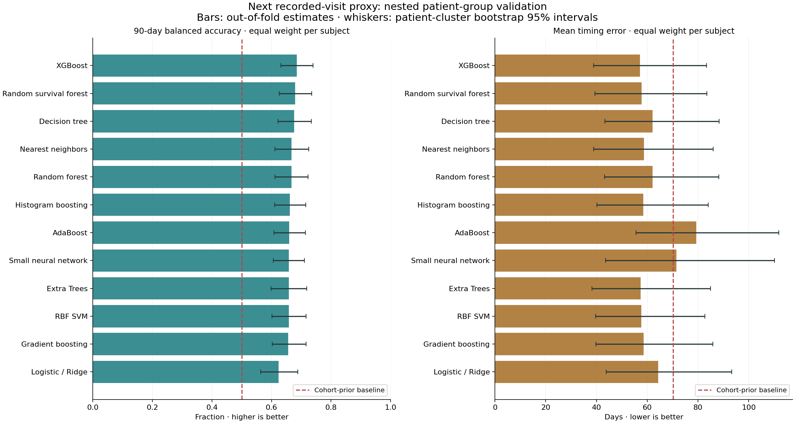

# Local 12-model benchmark

Run: `local-12-models-20261020`. Completed 2026-10-20T16:38:57.516015+00:00.

All training and evaluation ran locally. The deployed model artifact and AWS deployment were unchanged.

## Scope and evaluation

The target remains the next recorded imaging visit **conditional on another visit appearing in the archive**. These are follow-up proxy results, not verified retrieval prediction.

Development contains 603 known intervals from 118 subjects. The original 118-interval / 25-subject holdout was inspected previously; it is excluded from development and reported only as a diagnostic. It is not a newly untouched test.

- Five outer folds keep complete subjects together. Three inner grouped folds select settings and thresholds using only each outer training partition.
- Twelve model families each compare two regularization/complexity settings and two feature sets: history alone; history plus available masks and current-scan technical metadata.
- Preprocessing fits inside each fold. Patient ID, future dates, future scans, survival time and outcomes are excluded from predictors.
- Classification and timing settings are selected separately within each family. The 90-day threshold is selected on inner out-of-fold predictions, never the outer evaluation labels.
- Classification is ranked by patient-weighted balanced accuracy, then patient-weighted Brier score. Timing is ranked by patient-weighted MAE. Raw row-level metrics are also saved.
- Sample weights give each training subject equal total weight when supported. Nearest neighbors does not support fit sample weights. SVM's built-in probability calibration uses its training rows; the external nested folds still keep patients separated.
- Bootstrap intervals resample complete subjects 1,000 times. They quantify sampling uncertainty within these cohorts, not external validity or uncertainty from selecting among twelve families.

Current-scan metadata includes series count; measured TCGA source bytes/image count; available LUMIERE original voxel counts/field strength; and publisher mask shape summaries. Unavailable cohort-specific features stay missing and are imputed inside training folds. No image sizes are fabricated.

## Nested validation comparison

`BA` below is balanced accuracy with equal total weight per subject. `AUC` and `Brier` are also subject weighted. `Row MAE` weights every interval equally; `Subject MAE` gives subjects equal total weight. Differences from the earlier single-split result reflect this wider evaluation and weighting.

| Model family | Raw accuracy | Subject BA | Subject AUC | Subject Brier ↓ | Row MAE days ↓ | Subject MAE days ↓ |
| --- | ---: | ---: | ---: | ---: | ---: | ---: |
| XGBoost | 68.7% | 68.5% | 0.725 | 0.209 | 42.6 | 57.2 |
| Random survival forest | 66.5% | 67.9% | 0.733 | 0.205 | 43.4 | 57.7 |
| Decision tree | 67.2% | 67.6% | 0.729 | 0.217 | 47.2 | 62.1 |
| Nearest neighbors | 66.3% | 66.7% | 0.736 | 0.210 | 43.0 | 58.7 |
| Random forest | 68.3% | 66.7% | 0.737 | 0.205 | 45.7 | 62.1 |
| Histogram boosting | 67.3% | 66.2% | 0.710 | 0.219 | 43.1 | 58.4 |
| AdaBoost | 69.8% | 65.9% | 0.687 | 0.219 | 53.1 | 79.4 |
| Small neural network | 67.8% | 65.9% | 0.669 | 0.218 | 53.9 | 71.5 |
| Extra Trees | 61.0% | 65.8% | 0.740 | 0.203 | 42.8 | 57.4 |
| RBF SVM | 63.2% | 65.8% | 0.680 | 0.220 | 44.0 | 57.7 |
| Gradient boosting | 64.7% | 65.6% | 0.700 | 0.221 | 43.2 | 58.5 |
| Logistic / Ridge | 62.7% | 62.4% | 0.698 | 0.220 | 46.4 | 64.3 |
| Cohort-prior / median baseline | 56.6% | 50.0% | 0.507 | 0.245 | 51.0 | 70.1 |
| Last-gap rule (hard classification) | 67.2% | 61.7% | 0.617 | 0.345 | 56.2 | 77.7 |



## Leading candidates

**Classification and timing: XGBoost.**

Nested subject-weighted BA 68.5% (95% interval 63.1%–74.0%); raw accuracy 68.7%; subject AUC 0.725.

Row MAE 42.6 days; subject-weighted MAE 57.2 days (95% interval 38.9–83.3).

Paired improvement over the cohort baseline: BA interval 13.1 to 24.0 percentage points; timing improvement interval 8.4 to 17.8 days.

### Cohort breakdown for the classification leader

| Cohort | Intervals / subjects | Raw accuracy | Subject BA | Subject AUC | Row MAE | Subject MAE |
| --- | ---: | ---: | ---: | ---: | ---: | ---: |
| LUMIERE | 412 / 69 | 64.8% | 66.2% | 0.689 | 38.4 | 43.3 |
| TCGA-GBM | 191 / 49 | 77.0% | 72.5% | 0.750 | 51.7 | 76.7 |

Against the deterministic last-gap rule, the classification leader's paired subject-BA improvement has a 95% interval of 2.0 to 12.1 percentage points. Its raw accuracy improvement is only 1.5 points. This stronger baseline comparison limits any headline claim.

There are 4 development intervals longer than a year, across 4 subjects; the longest is 1462 days. These records remain in the evaluation. Sparse subjects with long gaps have greater influence under equal-subject weighting, widening the timing uncertainty.

## Can we rely on this accuracy?

The predeclared exploratory classification screen requires at least 70% subject-weighted balanced accuracy, AUC 0.75, a positive lower confidence bound for baseline improvement, and lower Brier score than baseline.

Classification screen: **not met**. Even a pass requires new independent subjects and actual retrieval labels before relying on retrieval decisions.

The separate practical timing screen is subject-weighted MAE <=35 days. Best observed: 57.2 days — **not met**.

The terminal outcomes remain unknown; no synthetic negatives, oversampled copies in evaluation, favourable patient split, or edited targets were used to raise the reported accuracy. Source-specific acquisition patterns may limit transfer to a different archive. This run is exploratory model comparison, not new prospective evidence.

Optimization warnings are retained in the fold/model files. The small neural network hit its configured iteration limit in some fits; its scores are reported with that limitation.

## Previously inspected holdout: diagnostic only

These scores are saved for transparency and are not used for selection. Multiple comparisons on this already viewed set do not make its best score an independent accuracy claim.

| Model | Raw accuracy | Subject BA | Row MAE days |
| --- | ---: | ---: | ---: |
| XGBoost | 66.9% | 58.2% | 40.4 |
| Random survival forest | 64.4% | 57.8% | 41.1 |
| Decision tree | 66.1% | 57.2% | 42.3 |
| Nearest neighbors | 60.2% | 51.6% | 42.6 |
| Random forest | 66.9% | 59.0% | 41.9 |
| Histogram boosting | 66.9% | 59.3% | 44.1 |
| AdaBoost | 66.1% | 57.0% | 49.6 |
| Small neural network | 68.6% | 56.2% | 46.3 |
| Extra Trees | 55.1% | 48.3% | 41.9 |
| RBF SVM | 67.8% | 55.8% | 41.8 |
| Gradient boosting | 69.5% | 61.8% | 41.4 |
| Logistic / Ridge | 62.7% | 60.2% | 43.6 |

## Saved evidence

- `leaderboard.csv`, `results.json`: all twelve aggregate comparisons; all raw/weighted metrics.
- `protocol.json`: fixed selection rules, input/code checksums, package versions and data counts.
- `folds/*.json`: every candidate setting, inner-CV result, selected threshold, outer-fold result and convergence warning.
- `models/*.json`: final configuration, full estimator representations, cohort metrics, bootstrap intervals and model artifact checksum.
- Private local outputs: `dataset/processed/longitudinal/benchmarks/local-12-models-20261020/` contains input rows, fold assignments, all candidate inner predictions, outer/holdout predictions and twelve final `.pkl` model bundles. These patient-level outputs and fitted binaries stay ignored by Git.
- `selection.json`: exploratory classification/timing choices and proof that the deployed model artifact was unchanged.

- `audit.json`: all 12 model bundles reload successfully and reproduce saved predictions within CSV storage precision (tolerance: 1e-6 probability, 0.001 day). A full-precision input snapshot is preserved privately; production artifact checksum is unchanged. Also includes the last-gap rule comparison and long-interval audit.

Pickle bundles are local trusted Python artifacts tied to the saved package versions; they are not portable deployment artifacts. No production model or AWS storage setting was changed.

## Reproduce / resume

```powershell
python -m pip install -r src/ml_model/longitudinal/requirements-benchmark.txt
python -m pip install --no-deps scikit-survival==0.25.0
python src/ml_model/longitudinal/benchmark.py --run-id local-12-models-20261020
python src/ml_model/longitudinal/benchmark_audit.py --run-id local-12-models-20261020
python src/ml_model/longitudinal/benchmark_report.py --run-id local-12-models-20261020
```

Partial runs require identical input, protocol and benchmark code. Completed folds are checkpointed. Completed-run aggregation permits a runner-only reporting repair when model/data code is unchanged; original training source checksums remain intact and the reporting revision is recorded in `completed_resume_provenance.json`. `original_sources/` preserves the source used for training. Use a new run ID when changing the experiment.

Method references: [scikit-learn grouped cross-validation](https://scikit-learn.org/stable/modules/cross_validation.html#stratifiedgroupkfold), [balanced accuracy](https://scikit-learn.org/stable/modules/model_evaluation.html#balanced-accuracy-score), [XGBoost parameters](https://xgboost.readthedocs.io/en/stable/parameter.html), [Random Survival Forests](https://doi.org/10.1214/08-AOAS169).
