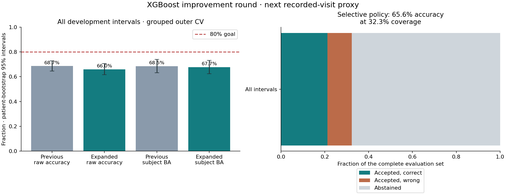

# XGBoost improvement round

Completed: 2026-10-20T17:00:35.771859+00:00. Local only; AWS and the production model artifact are unchanged.

The target remains a next recorded imaging visit within 90 days, conditional on a later archived visit. **These are not actual file-retrieval labels.** This is a second exploratory round on previously studied cohorts; it does not create a new independent test set.

**80% was not achieved in this run.** The larger search scored 66.0% full-set raw accuracy versus 68.7% previously. A fixed median-imputed setting reached 69.3%, with subject-BA 68.1%. The expanded candidate is not promoted; the previous local model remains preferable under the original subject-BA criterion.

## Why the earlier model was below 80%

1. **Small independent sample.** There are 118 labelled development subjects and 603 intervals. Several intervals from one person do not provide the same evidence as new independent people.
2. **A generalization gap.** The previous model scored 80.2% subject-weighted balanced accuracy on training patients, compared with 68.5% in grouped outer validation. This is consistent with limited generalization; a training score of 80% is not unseen-patient performance.
3. **Missing/over-aggregated features and cohort differences.** TCGA has no mask summaries in the input release used here. The combined three-region summary is unavailable for 75 of 412 LUMIERE development intervals (18.2%). Of those, 43 still have one or two usable regional summaries, which the old aggregate did not preserve separately; 32 have no region-volume summary. This does not prove the MRI or mask file is absent. The new regional feature columns preserve available information without inventing zero volumes. Earlier cohort accuracies were 77.0% TCGA and 64.8% LUMIERE.
4. **A coarse time boundary.** LUMIERE has 40 development intervals recorded as 91 days. With week-floor anonymization, such a recorded difference can correspond to a true gap of 85–97 days. The true side of a 90-day calendar boundary is not identifiable from these data.
5. **Omitted dynamic information.** The earlier compact model used current summaries and interval aggregates but not many current-versus-prior changes or detailed radiomics. This is a plausible feature limitation, tested below; it is not proof that every missing feature explains an error.

Attendance, scheduling and actual file retrieval also depend on information absent from the dataset. The audit identifies limitations and hypotheses, not an estimated irreducible-error bound or proof that 80% is impossible.

## What was changed and tested

- 73 fixed candidate configurations, evaluated in five outer patient-group folds with three inner patient-group folds for tuning.
- Original 17 predictors versus 49 temporal predictors versus 187 temporal/radiomic predictors. All derived changes use strictly earlier visits and the current visit; no future mask or outcome is included.
- XGBoost native missing-value handling, alongside a fixed median-imputed reference.
- Pooled training versus separate cohort models, six regularization/complexity settings, and thresholds tuned only on inner predictions.
- A sensitivity experiment gives uncertain 91-day LUMIERE training intervals a soft label of 21/49 under independent uniform within-week offsets. This is an explicit assumption, not recovered ground truth. All original hard evaluation labels are unchanged in every headline score.
- A separate abstaining policy: inner accuracy >=80%, subject-weighted balanced accuracy >=75%, coverage >=30%, at least 15 accepted subjects and at least 15 accepted examples of each class. Its predictions are evaluated separately; abstained cases remain in the coverage denominator.

No difficult patients, long gaps or near-boundary cases were removed from the full evaluation. The original 118-interval holdout remains excluded from tuning and labelled diagnostic-only because it was inspected in previous rounds.

## Complete-coverage results

Scores below cover all 603 development intervals in the same original outer folds. BA gives equal total weight to each patient; row MAE weights intervals equally, subject MAE weights patients equally.

| Metric | Previous XGBoost | Improvement search |
| --- | ---: | ---: |
| Raw 90-day accuracy | 68.7% | 66.0% |
| Subject-weighted balanced accuracy | 68.5% | 67.7% |
| Subject-weighted AUC | 0.725 | 0.708 |
| Subject-weighted Brier (lower better) | 0.209 | 0.221 |
| Row timing MAE days | 42.6 | 43.2 |
| Subject timing MAE days | 57.2 | 57.8 |

New raw-accuracy 95% patient-bootstrap interval: 61.7%–70.7%. Subject-BA interval: 62.5%–73.3%.

Paired errors: 25 previously wrong predictions became correct; 41 previously correct predictions became wrong.

| Cohort | Intervals | Raw accuracy | Subject BA |
| --- | ---: | ---: | ---: |
| LUMIERE | 412 | 61.4% | 64.3% |
| TCGA-GBM | 191 | 75.9% | 73.3% |

## Selective / uncertain predictions

The separately selected cautious policy accepted 195 of 603 intervals (32.3% coverage), abstaining on 408.

Accuracy on accepted cases: **65.6%**, with a 95% interval of 58.7%–72.6%. Subject-weighted balanced accuracy: 64.3%.

This is a selected-coverage result, not full-set accuracy. A point estimate above 80% would not establish an 80% lower confidence bound or validate actual retrieval. Remaining cases require abstention/fallback, not a silent prediction.

No single selective configuration met the inner criteria in all five training partitions. The final bundle therefore contains no supported selective head. The outer selective procedure also fell below 80%.



## Which hypotheses helped?

Each restricted search below chooses configurations using inner folds only, then evaluates the outer rows. Groups overlap; these are exploratory comparisons, not causal effect estimates. The median reference has a single fixed configuration while other searches tune settings.

| Restricted search | Raw accuracy | Subject BA | Subject AUC |
| --- | ---: | ---: | ---: |
| Original compact features | 67.3% | 67.4% | 0.718 |
| Add history and current/prior changes | 68.3% | 67.9% | 0.725 |
| Add current radiomics | 67.0% | 67.6% | 0.716 |
| Pooled cohorts | 68.0% | 68.4% | 0.716 |
| Separate cohort models | 64.5% | 66.6% | 0.692 |
| Hard original training labels | 66.0% | 67.7% | 0.708 |
| Soft weekly-boundary training sensitivity | 66.0% | 66.9% | 0.699 |
| Native missing-value handling | 65.5% | 67.1% | 0.709 |
| Fixed median-imputed reference | 69.3% | 68.1% | 0.733 |

## What can be concluded

The unchanged full-coverage 80% target is **not met**. Any cohort-only or selective score must retain its cohort/coverage label. The previously viewed diagnostic holdout is not used to choose a successful headline.

The final model's in-sample accuracy is 82.3%; grouped validation remains the relevant comparison for new patients. Further rounds on the same cohorts add researcher-selection optimism and need independent external evaluation.

A valid next step toward reliable retrieval prediction needs timestamped access events, observation coverage and source-time scheduling/context information. The current experiment cannot infer those missing labels or exact calendar dates.

## Saved files

- `diagnosis.json`, `partial_mask_audit.json`, `previous_training_audit.json`: measured limitations, partial-region summary loss, and training-versus-validation gap.
- `protocol.json`, `environment.json`, `original_sources/`: fixed candidate search, label/coverage rules, dependency versions and original code snapshots.
- `folds/*.json`: all 73 inner candidate scores per outer fold, selected configurations and outer results.
- `results.json`: full, cohort, selective, uncertainty and diagnostic-holdout results; model checksum and reload evidence.
- `configuration_summary.csv`: all candidate inner scores; these are tuning scores, not the headline evaluation.
- `ablation.csv`, `ablation.json`: restricted-search outer comparisons.
- `feature_gain.json`: training-only model gain summaries; not causal feature importance.
- `recommendation.json`: expanded model not promoted; previous local XGBoost retained. `model_reload_audit.json` verifies full/timing/available selective fold bundles reload with matching predictions.
- Private local path: `dataset/processed/longitudinal/benchmarks/xgboost-improvement-20261020/` stores full-precision features, all candidate predictions, fold assignments, fold model bundles and final classifier/timing/selective models.
- The final saved model reloads and reproduces its predictions. The production artifact checksum is unchanged, and no AWS API is called by this workflow.

```powershell
python src/ml_model/longitudinal/improve_xgboost.py --run-id xgboost-improvement-20261020
python src/ml_model/longitudinal/improvement_diagnose.py --run-id xgboost-improvement-20261020
python src/ml_model/longitudinal/improvement_ablation.py --run-id xgboost-improvement-20261020
python src/ml_model/longitudinal/improvement_report.py --run-id xgboost-improvement-20261020
```

Sources: [XGBoost missing-value handling](https://xgboost.readthedocs.io/en/stable/faq.html#how-to-deal-with-missing-values), [XGBoost regularization parameters](https://xgboost.readthedocs.io/en/stable/parameter.html), [LUMIERE author documentation](https://github.com/ysuter/gbm-data-longitudinal).
